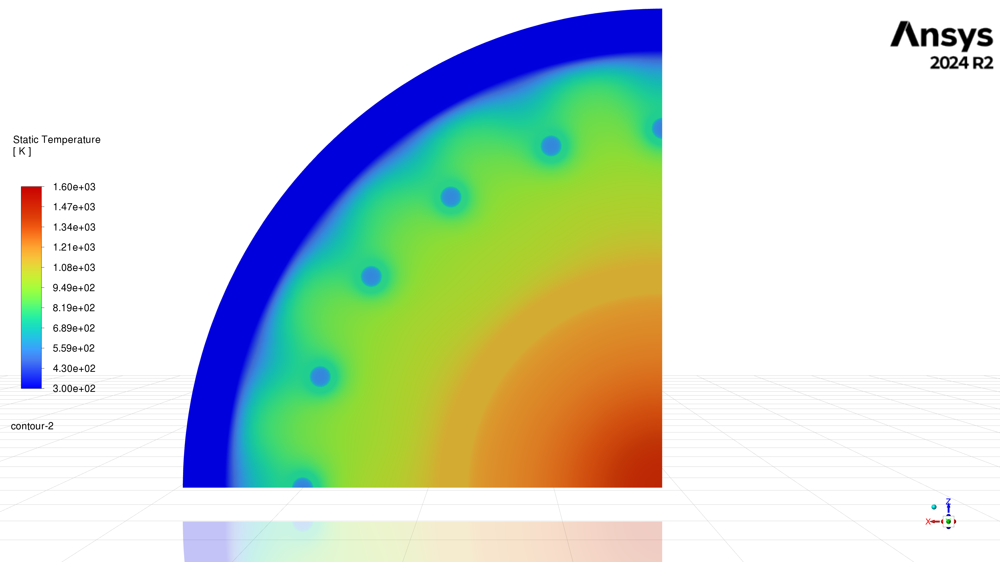
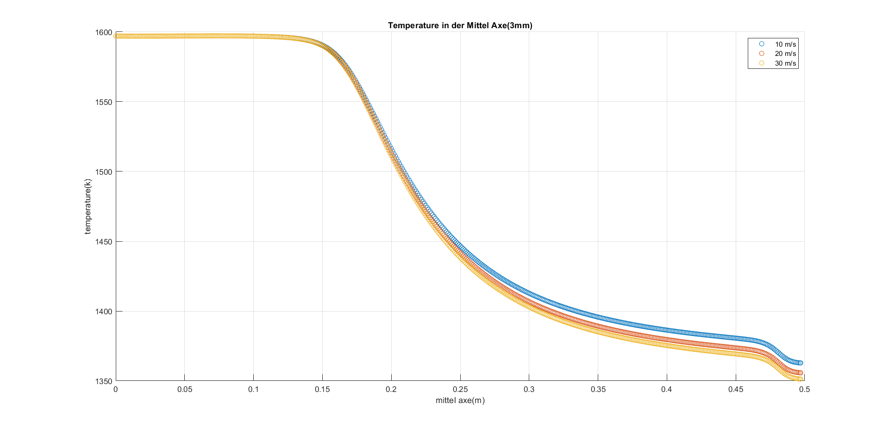
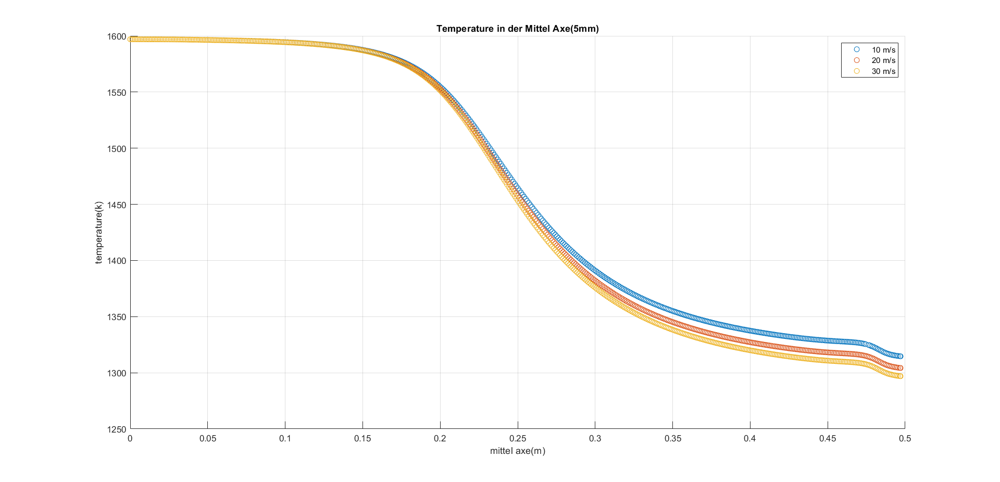
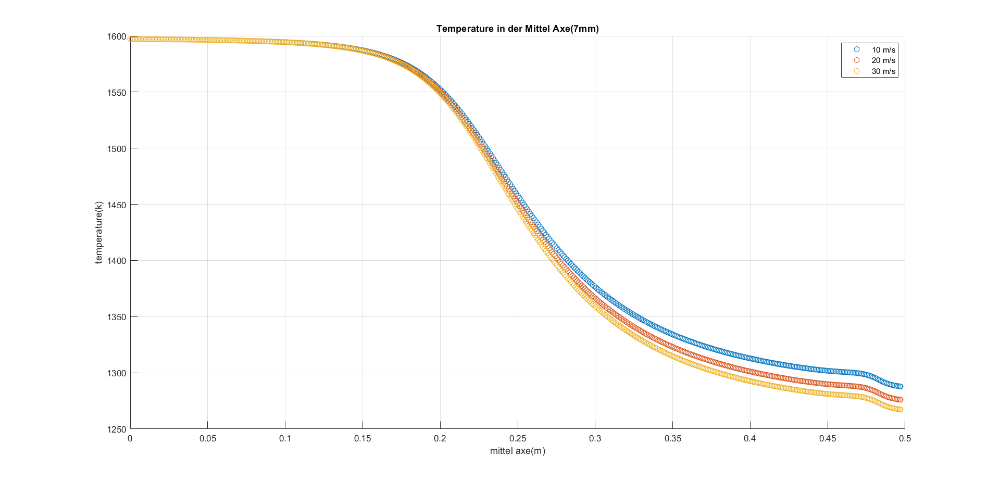

# Temperaturverteilung in einer gekühlten H₂/O₂-Brennkammer

CFD-Analyse der thermischen Belastung einer aktiv gekühlten H₂/O₂-Brennkammer als Grundlage für die spätere Festigkeitsauslegung.

**Kontext:** Betreutes Forschungsprojekt (Studienmodul) am Institut InEV, Jade Hochschule, im Studiengang Maschinenbau M.Eng.
**Status:** abgeschlossen
**Software:** Ansys SpaceClaim, Fluent Meshing, Ansys Fluent, MATLAB

> Dieses Projekt ist eigenständig und unabhängig von meiner Masterarbeit, die eine andere, dampfgekühlte Brennkammer bei 50 bar behandelt.

## Aufgabe

Kalte Luft wird durch Bohrungen in das äußere Gehäuse eingeleitet und entlang der Wand geführt. Heißer Wasserdampf steigt im Innenraum auf, wird am Deckel umgelenkt und strömt durch einen schmalen Spalt in den Ringraum zwischen Innen- und Außenwand.

Untersucht wurde der Einfluss von zwei Parametern:

- Spaltweite oben zwischen Innenwand und Deckel: 3 / 5 / 7 mm
- Kühlluftgeschwindigkeit: 10 / 20 / 30 m/s

Die vollfaktorielle Kombination ergibt 9 stationäre Simulationen.

## Vorgehen

- **Geometrie:** SpaceClaim. Wegen der Periodizität wurde nur ein 90°-Viertelmodell mit periodischer Randbedingung simuliert. Drei Varianten, die sich nur im oberen Spalt unterscheiden.
- **Netz:** Fluent Meshing, Poly-Hexcore, 7.480.111 Zellen, Ziel y⁺ = 0,05 (y⁺ < 1), max. Skewness 0,88.
- **Modell:** druckbasiert, stationär, gekoppelt. Realizable k-ε mit Enhanced Wall Treatment, Second-Order-Upwind, konjugierte Wärmeübertragung (CHT). Die Verbrennung selbst wird nicht modelliert.
- **Randbedingungen:** Dampf 5,587·10⁻³ kg/s bei 1.600 K, Kühlluft 303,15 K, Außenwand konstant 300 K.
- **Materialien:** Edelstahl 304 für alle festen Bereiche außer der Innenwand. Vorgegeben war für die Innenwand Keramik (Al₂O₃). Da sie in der Fluent-Datenbank nicht verfügbar war, wurde ersatzweise „Aluminum-Alloy-Cast 518“ verwendet und das dokumentiert.

## Netzunabhängigkeit

Mittlere Luft-Austrittstemperatur bei skalierter Elementgröße:

| Netz | Zellen | T_Luft,aus |
|---|---|---|
| Grob | ≈ 4,2 Mio. | 760,4 K |
| Referenz | ≈ 7,5 Mio. | 747,5 K |
| Fein | ≈ 8,7 Mio. | 736,0 K |
| Sehr fein | ≈ 9,2 Mio. | 736,2 K |

Das Referenznetz weicht ≈ 1,73 % vom groben und ≈ 1,54 % vom feinen Netz ab und wurde für alle weiteren Auswertungen verwendet.

## Ergebnisse

- Kleinerer Spalt und höhere Kühlluftgeschwindigkeit senken die Wandtemperaturen. Am kritischsten ist der obere Bereich nahe dem Deckel.
- Ein kleinerer Spalt begrenzt den Wärmeaustausch mit der Kühlluft: Die Luft-Austrittstemperatur sinkt, die Dampfzone bleibt heißer. Die Wärmepfade wirken also gegenläufig.
- Wärmestrom an der Außenwand bei 10 m/s: −3.092 W (3 mm), −3.771 W (5 mm), −4.152 W (7 mm).
- Niedrigste Dampftemperatur bei 7 mm und 30 m/s mit 1248,9 K, rund 7,6 % unter der heißesten Konfiguration (3 mm, 10 m/s, 1351,1 K). Diese Kombination diente als Referenzpunkt für die weitere Auswertung.

## Hinweise

- Rein thermische Untersuchung, keine Verbrennungsmodellierung.
- Die Ersatzwerkstoffwahl für die Innenwand beeinflusst die Ergebnisse. Sie ist eine dokumentierte Vereinfachung.

## Repository-Inhalt

Dieses Repository dokumentiert Vorgehen und Ergebnisse. Fluent-Case- und Datendateien sind aufgrund ihrer Größe und der Institutszugehörigkeit nicht enthalten.

Portfolio mit Abbildungen: <https://pouria-kamali.de/projekt-brennkammer.php>

## Abbildungen

### Temperaturkonturen

Kontur der statischen Temperatur (Skala 300 bis 1.600 K) im 90°-Viertelmodell, Ansys Fluent 2024 R2. Je Spaltweite (3 / 5 / 7 mm) und Kühlluftgeschwindigkeit (10 / 20 / 30 m/s) liegen drei Schnittebenen bei 50, 250 und 450 mm vor.

| Spalt | Luft | 50 mm | 250 mm | 450 mm |
|---|---|---|---|---|
| 3 mm | 10 m/s | [Bild](images/konturen/3mm_10ms_50mm.png) | [Bild](images/konturen/3mm_10ms_250mm.png) | [Bild](images/konturen/3mm_10ms_450mm.png) |
| 3 mm | 20 m/s | [Bild](images/konturen/3mm_20ms_50mm.png) | [Bild](images/konturen/3mm_20ms_250mm.png) | [Bild](images/konturen/3mm_20ms_450mm.png) |
| 3 mm | 30 m/s | [Bild](images/konturen/3mm_30ms_50mm.png) | [Bild](images/konturen/3mm_30ms_250mm.png) | [Bild](images/konturen/3mm_30ms_450mm.png) |
| 5 mm | 10 m/s | [Bild](images/konturen/5mm_10ms_50mm.png) | [Bild](images/konturen/5mm_10ms_250mm.png) | [Bild](images/konturen/5mm_10ms_450mm.png) |
| 5 mm | 20 m/s | [Bild](images/konturen/5mm_20ms_50mm.png) | [Bild](images/konturen/5mm_20ms_250mm.png) | [Bild](images/konturen/5mm_20ms_450mm.png) |
| 5 mm | 30 m/s | [Bild](images/konturen/5mm_30ms_50mm.png) | [Bild](images/konturen/5mm_30ms_250mm.png) | [Bild](images/konturen/5mm_30ms_450mm.png) |
| 7 mm | 10 m/s | [Bild](images/konturen/7mm_10ms_50mm.png) | [Bild](images/konturen/7mm_10ms_250mm.png) | [Bild](images/konturen/7mm_10ms_450mm.png) |
| 7 mm | 20 m/s | [Bild](images/konturen/7mm_20ms_50mm.png) | [Bild](images/konturen/7mm_20ms_250mm.png) | [Bild](images/konturen/7mm_20ms_450mm.png) |
| 7 mm | 30 m/s | [Bild](images/konturen/7mm_30ms_50mm.png) | [Bild](images/konturen/7mm_30ms_250mm.png) | [Bild](images/konturen/7mm_30ms_450mm.png) |

### Temperatur auf der Mittelachse

Temperaturverlauf entlang der Mittelachse für 10 / 20 / 30 m/s, je Spaltweite:

| 3 mm | 5 mm | 7 mm |
|---|---|---|
|  |  |  |

## Skripte

`scripts/temperatur_mittelachse.m` liest die aus Fluent exportierten Mittelachsen-Daten (Textdateien) ein, sortiert sie nach der Achsenkoordinate und plottet die drei Geschwindigkeiten. Die Rohdaten sind nicht enthalten.
